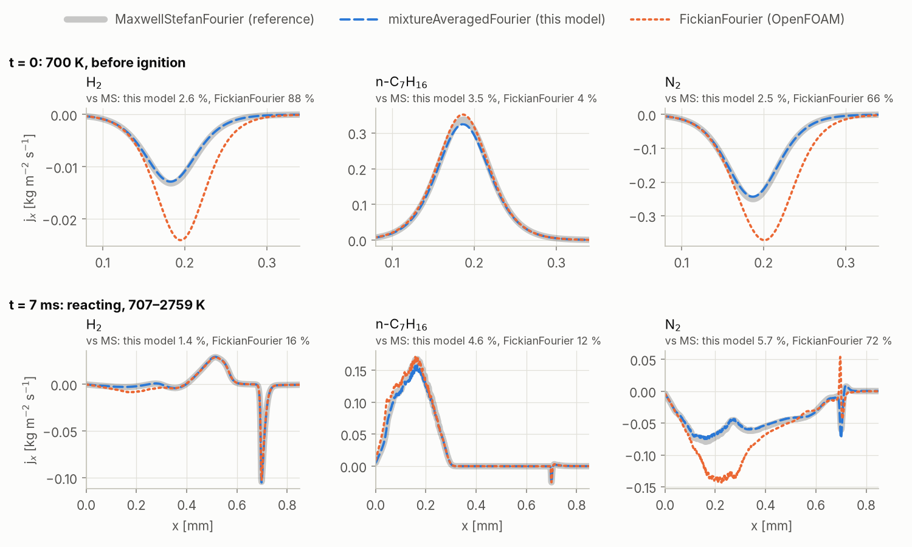
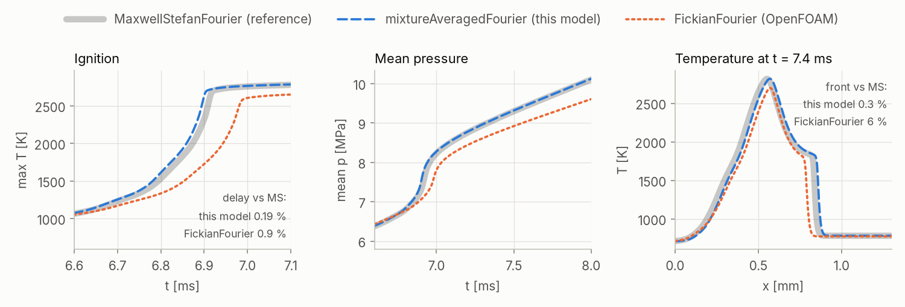
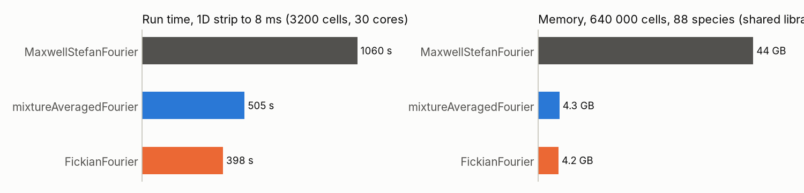
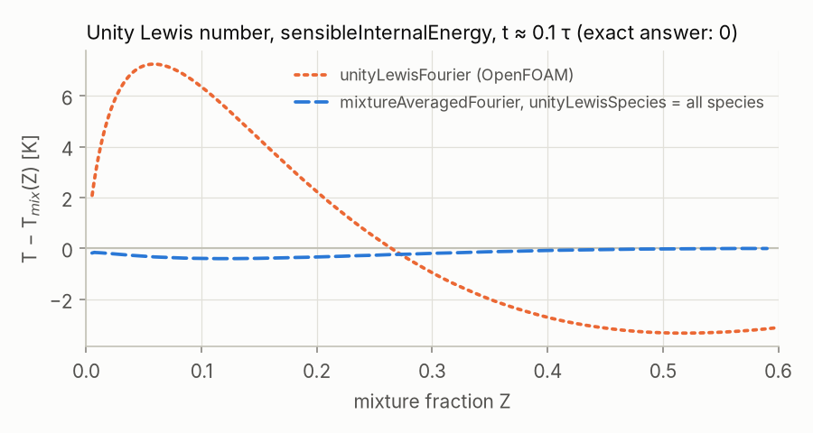

# mixtureAveragedTransport

Mixture-averaged species diffusion for **OpenFOAM** (openfoam.org): a laminar thermophysical transport model, `mixtureAveragedFourier`, for multicomponent reacting flows (`multicomponentFluid` solver). It is the same mixture-averaged model as in Cantera and Chemkin.

[中文简介见下文](#中文简介)

---

## Theory and Implementation

For a more detailed explanation of the physical principles and numerical methods behind `mixtureAveragedFourier`, see the companion article on my personal website:

**[Mixture-Averaged Transport — Theory and Implementation](https://stone1fan.com/posts/mixture-averaged-transport/)**

It discusses mixture-averaged diffusion coefficients, mole-fraction-driven species fluxes, correction velocity, heat-flux coupling, and the reasoning behind the numerical implementation. This README focuses on the model's features, validation, and usage.

---

## Why

OpenFOAM has three laminar diffusion models for multicomponent mixtures:

| Model | Accuracy | Cost |
|---|---|---|
| `unityLewisFourier` | all species diffuse like heat; no differential diffusion | cheap |
| `FickianFourier` | one diffusion coefficient per species. It differs from the Cantera/Chemkin mixture-averaged model in three ways: (1 − X_i) in D_i, no ∇ln W term, and the default species absorbs the mass imbalance | cheap |
| `MaxwellStefanFourier` | exact multicomponent diffusion | expensive: with an 88-species mechanism about 70 KB of memory per cell |

`mixtureAveragedFourier` is in between. Its accuracy is close to Maxwell–Stefan, its memory is that of the Fickian model, and a run takes about half the time of a Maxwell–Stefan run. This makes fine-grid 2D DNS with skeletal mechanisms of 80–100 species feasible on a single workstation.

## What it does

- **Mixture-averaged diffusion coefficients.** Each species gets D_i = (1 − Y_i) / Σ_{j≠i} (X_j / D_ij). The binary coefficients D_ij(p, T) are read from the same `D` dictionary that `MaxwellStefanFourier` uses, so an existing Maxwell–Stefan setup (for example one generated by [chemkin2foam](https://github.com/Fkstone/chemkin2foam)) works by changing the model name only.
- **Mole-fraction driving force.** The flux is j_i = −ρ D_i (W_i/W) ∇X_i, which includes the mean-molecular-weight gradient term. This matters at interfaces between heavy fuel vapour and air.
- **Correction velocity.** The species fluxes sum to zero exactly. No single "default" species has to absorb the error.
- **Consistent heat flux.** The heat flux is Fourier conduction plus the enthalpy carried by species diffusion, Σ h_s,i j_i. It is correct for both energy forms, `sensibleEnthalpy` and `sensibleInternalEnergy`.
- **Stable at large time steps.** Diffusion is treated implicitly, with the mixture-averaged correction terms added as a deferred correction. The scheme stays stable when D Δt/Δx² ≫ 1, where a simple explicit treatment of these terms blows up.
- **Low memory.** Only the D_i and four fields shared by all species are stored, about the same memory as `FickianFourier`.
- **Dynamic load balancing.** The model works with mesh redistribution (`loadBalancer`), which reacting DNS needs because the chemistry cost moves with the flame.
- **Optional `unityLewisSpecies`.** The listed species get D_i = κ/(ρ c_p) (Lewis number 1); all other species stay mixture-averaged. This switches off differential diffusion of chosen species, for example only the fuel. Listing all species gives an exact unity-Lewis-number model with the correct enthalpy flux for either energy form (see Validation).

Not included: Soret (thermal) diffusion, the Dufour effect, turbulence models (laminar only).

## Validation

These tests used the 88-species n-heptane skeletal mechanism of Lu & Law at 6 MPa. Unless noted, the test case is a closed 1D strip (3.2 mm, 1 µm grid, 700 K) with a slab of pure n-heptane vapour against lean H2/air: the mean molecular weight changes from 100 to 25 g/mol across the interface. The diffusion models compared below use the same binary diffusion coefficients D_ij.

### Species fluxes

On 1D profiles of T and Y, the fluxes match Cantera's mixture-averaged transport to 1e-4 (relative). The flux sum is zero to round-off.

The figure compares the fluxes of the three OpenFOAM models on the same fields, before ignition and in the burning strip. Maxwell–Stefan is the reference: it agrees with Cantera's multicomponent transport to 1.5e-4. For the species shown this model is within 1.4–5.7 % of it (6.9 % for O2 before ignition). `FickianFourier` is off by up to 88 % for H2 and 72 % for N2.

<picture>
  <source media="(prefers-color-scheme: dark)" srcset="docs/fluxes_dark.png">
  
</picture>

### Autoignition vs Maxwell–Stefan

In the 1D strip, against `MaxwellStefanFourier`:
- the ignition delay differs by 0.2 % (`FickianFourier`: 0.9 %);
- the flame-front position differs by about 1 % (`FickianFourier`: up to 9 %);
- the mean pressure differs by 0.2 % at 8 ms (`FickianFourier`: 5 %).

<picture>
  <source media="(prefers-color-scheme: dark)" srcset="docs/strip_dark.png">
  
</picture>

### Cost

- **Run time.** The strip run takes 48 % of the Maxwell–Stefan time and 1.27 times the `FickianFourier` time.
- **Memory.** On 640 000 cells with 88 species this model needs about as much memory as `FickianFourier`: 8.25 GB against 8.07 GB with chemistry off, of which about 3.9 GB are the shared libraries of the 30 processes (the figure leaves them out). `MaxwellStefanFourier` stores one field per species pair and needed about 44 GB, measured during its first time step.

<picture>
  <source media="(prefers-color-scheme: dark)" srcset="docs/cost_dark.png">
  
</picture>

### `unityLewisSpecies`

Fluxes match a reference built from the cell values of κ, ρ and c_p to 8e-5.
- With all species listed, the temperature stays on the adiabatic mixing line before ignition: within 0.4 K at 0.1 of the ignition delay.
- OpenFOAM's own `unityLewisFourier` diffuses `he` with κ/c_v when the energy variable is `sensibleInternalEnergy`. In a strip with 800 K H2/air against 600 K n-heptane this heated the lean side by 4–7 K at 0.1 and by 10–14 K at 0.6 of the ignition delay.

<picture>
  <source media="(prefers-color-scheme: dark)" srcset="docs/unityLewis_dark.png">
  
</picture>

## Usage

Build the library in this directory with the OpenFOAM environment loaded:

```sh
wmake libso        # -> $FOAM_USER_LIBBIN/libmixtureAveragedTransport.so
```

In `system/controlDict`:

```
libs ("libmixtureAveragedTransport.so");
```

In `constant/thermophysicalTransport`:

```
simulationType laminar;

laminar
{
    model  mixtureAveragedFourier;

    // unityLewisSpecies (nc7h16);   // optional: these species get Le = 1

    D      // binary diffusion coefficients, as for MaxwellStefanFourier
    {
        o2-o2 { type binaryDiffusionCoefficient; ... }
        o2-n2 { ... }
        ...
    }
}
```

Tip: for the thermal conductivity of the mixture, `mixture coefficientWilkeMulticomponentMixture;` in `physicalProperties` (a standard OpenFOAM option) agreed with Cantera to 0–4 %. The default `multicomponentMixture` was 5–17 % low in our flames.

Tested with OpenFOAM 14 (openfoam.org) only.

## License

GPL-3.0, like OpenFOAM, from which this code is derived (`Fickian`, `FickianFourier`). See `LICENSE`.

---

## 中文简介

**原理与实现详解：** [在个人网站阅读 Mixture-Averaged Transport 原理文章](https://stone1fan.com/zh/posts/mixture-averaged-transport/)。文章介绍混合平均扩散系数、摩尔分数梯度驱动的扩散通量、修正速度，以及扩散与热通量的耦合等理论背景。

这是 **OpenFOAM** 的混合平均扩散模型 `mixtureAveragedFourier`，用于多组分层流反应流。它与 Cantera / Chemkin 中的 mixture-averaged 模型相同。

**为什么需要**：OpenFOAM 自带三种模型：
- `unityLewisFourier`：没有差异扩散。
- `FickianFourier`：在三处与标准的混合平均模型不同。
- `MaxwellStefanFourier`：精确但很贵，88 个组分时每个网格约 70 KB 内存。

本模型的精度接近 Maxwell–Stefan，内存与 Fick 模型相当，计算时间约为 Maxwell–Stefan 的一半。

**实现的功能**
- 由二元扩散系数计算每个组分的混合平均扩散系数，直接使用 `MaxwellStefanFourier` 的 `D` 字典。已有的 Maxwell–Stefan 设置（如 chemkin2foam 生成的）只需改模型名。
- 以摩尔分数梯度驱动扩散，并加修正速度，使各组分扩散通量之和严格为零。
- 热通量包含导热和组分扩散携带的焓，对显焓和显内能两种能量形式都正确。
- 隐式加延迟修正的时间离散，时间步很大时仍然稳定。
- 内存与 `FickianFourier` 相当；支持负载均衡时的网格重分配。
- 可选 `unityLewisSpecies`：指定组分的 Lewis 数为 1，其余组分仍按混合平均计算。例如可以只关掉燃料的差异扩散。列出全部组分就得到严格的单位 Lewis 数模型，并且能量通量正确。

**检验**（n-庚烷 88 组分骨架机理，6 MPa；对比图见上文 Validation）
- 组分通量与 Cantera 的混合平均输运相差 1e-4 以内。
- 与 Maxwell–Stefan 的通量相比，图中各组分相差 1.4–5.7 %；`FickianFourier` 最多差 88 %。
- 一维自燃算例与 Maxwell–Stefan 相比：
  - 着火时间差 0.2 %，火焰锋位置差约 1 %，平均压力差 0.2 %；
  - 计算时间为后者的 48 %。
- 64 万网格的内存为 8.25 GB，`FickianFourier` 为 8.07 GB，Maxwell–Stefan 约 44 GB。

不包含 Soret 效应和湍流模型。只在 OpenFOAM 14（openfoam.org）上测试过。许可证为 GPL-3.0。
